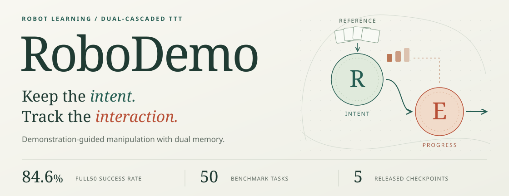
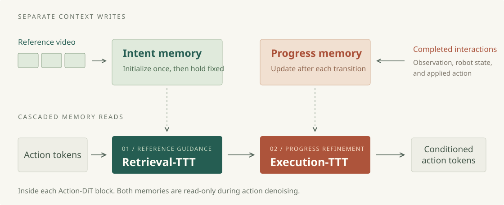

<a href="#models-and-results">
  <picture>
    <source media="(max-width: 600px)" srcset="docs/assets/hero-mobile.svg">
    
  </picture>
</a>

<p align="center">
  <a href="https://robodemo-2027.github.io/"><strong>Project Page</strong></a>
  &nbsp;&nbsp;&middot;&nbsp;&nbsp;
  <a href="https://huggingface.co/collections/mxk1998/robodemo-6afc7693656d0965ce5466bc"><strong>Model Collection</strong></a>
  &nbsp;&nbsp;&middot;&nbsp;&nbsp;
  <a href="#models-and-results"><strong>Results</strong></a>
  &nbsp;&nbsp;&middot;&nbsp;&nbsp;
  <a href="#installation"><strong>Get Started</strong></a>
  &nbsp;&nbsp;&middot;&nbsp;&nbsp;
  <a href="docs/smoke-evaluation.md"><strong>Runtime Verification</strong></a>
</p>

## Release Status

- [x] **Code:** model architecture, dual-memory inference, evaluator and environment.
- [x] **Models & results:** five checkpoints, trial plans, normalization and 3,600 episode logs.
- [x] **Verified:** all five models complete a 500-step simulator test. [View the runs](docs/smoke-evaluation.md).
- [ ] **Next release:** training code, training-data preparation and launch recipes.

## One Demonstration, Two Memories

A demonstration shows **what should happen**. Interaction history reveals
**what actually happened**. RoboDemo keeps these two kinds of context separate:
Retrieval-TTT retains the reference intent, while Execution-TTT accumulates
realized progress. The action expert reads them in that order, refining
reference guidance without overwriting it.

<a href="#evaluation">
  <picture>
    <source media="(max-width: 600px)" srcset="docs/assets/memory-mobile.svg">
    
  </picture>
</a>

The reference can be a human demonstration or a retrieved robot video.
Learned policy parameters remain fixed during evaluation; the two fast-weight
memories have independent update schedules.

## Models And Results

**Full50: 84.6% success across all 50 Imitator Game tasks.**
[RoboDemo-full50](https://huggingface.co/mxk1998/RoboDemo-full50), at
240,000 updates, completes 1,692 of 2,000 episodes.

The nested-corpus models use 200 Seen and 200 Unseen episodes each:

| Model | Checkpoint | Reference | Seen SR (%) | Unseen SR (%) |
| --- | ---: | --- | ---: | ---: |
| [RoboDemo-c15](https://huggingface.co/mxk1998/RoboDemo-c15) | 90,000 | Human | 89.5 | 0.0 |
| [RoboDemo-c30](https://huggingface.co/mxk1998/RoboDemo-c30) | 160,000 | Human | 94.0 | 0.5 |
| [RoboDemo-c45](https://huggingface.co/mxk1998/RoboDemo-c45) | 260,000 | Human | 88.5 | 11.5 |
| [RoboDemo-c15-wo](https://huggingface.co/mxk1998/RoboDemo-c15-wo) | 100,000 | Retrieved robot | 90.0 | 0.0 |

The C15/C30/C45 Seen mean is **90.7%**.
For C15-wo, Unseen denotes tasks held out from policy training; task-matched
robot references are supplied from the benchmark training bank.

[All 360 task-level results](results/README.md) &middot;
[Download the five checkpoints](https://huggingface.co/collections/mxk1998/robodemo-6afc7693656d0965ce5466bc)

Each linked checkpoint is the one used for its reported results.
Weights are hosted on Hugging Face; this repository contains the code and logs.

## Installation

**Linux &middot; Python 3.10 &middot; PyTorch 2.6.0 / CUDA 12.4**

The evaluator uses Transformers 4.57.6, SAPIEN 3.0.3 and Gymnasium 0.29.1.
See [environment setup](environments/README.md) for the full dependency
inventory and rendering configuration.

<details>
<summary><strong>Install the evaluation environment</strong></summary>

```bash
python -m venv .venv
source .venv/bin/activate
pip install torch==2.6.0 torchvision==0.21.0 \
  --index-url https://download.pytorch.org/whl/cu124
pip install -r environments/requirements-evaluation.txt
pip install flash-attn==2.7.4.post1 --no-build-isolation
```

</details>

## Data Preparation

Follow the [Imitator Game project](https://imitator-game.github.io/) to obtain
the IG-10K dataset, simulator and assets. Use the paired human-reference and
simulation subsets. Dataset media are distributed by the benchmark.

<details>
<summary><strong>Configure data, simulator and pretrained encoder paths</strong></summary>

```bash
export ROBODEMO_DATA_ROOT=/data/IG-10K-Dataset
export IMITATOR_GAME_ROOT=/path/to/ImitationGame
export MS_ASSET_DIR=/data/maniskill
export ROBODEMO_QWEN=/models/Qwen3-VL-4B-Instruct
export ROBODEMO_XR1=/models/Xiaomi-Robotics-1-5B
export ROBODEMO_VJEPA2_SOURCE=/path/to/vjepa2
export ROBODEMO_VJEPA2_WEIGHTS=/models/vjepa2-ac-vitg.pt
export PYTHONPATH="$IMITATOR_GAME_ROOT${PYTHONPATH:+:$PYTHONPATH}"
```

The pretrained components are
[Qwen3-VL](https://huggingface.co/Qwen/Qwen3-VL-4B-Instruct),
[Xiaomi-Robotics-1](https://huggingface.co/XiaomiRobotics/Xiaomi-Robotics-1-5B)
and [V-JEPA2](https://github.com/facebookresearch/vjepa2).
Their original distribution terms apply.

`configs/*_trials.json` contains the reference identities and seeds used by the
reported experiments. Paths inside those files are relative to the IG-10K
dataset root. C15-wo also includes its 400 selected robot-reference identities
and candidate scores.

</details>

## Evaluation

Use a downloaded policy checkpoint and a GPU allocated to your job:

```bash
CUDA_VISIBLE_DEVICES=0 python evaluation/evaluate.py \
  --model c15 \
  --checkpoint /models/RoboDemo-c15/pytorch_model.pt \
  --data-root "$ROBODEMO_DATA_ROOT" \
  --output outputs/c15
```

Choose `full50`, `c15`, `c30`, `c45` or `c15-wo`, with its corresponding
checkpoint. Use a new output directory for each evaluation.

| To evaluate | Add |
| --- | --- |
| One complete episode | `--max-episodes 1` |
| A nested-corpus split | `--split seen` or `--split unseen` |
| A task-level subset | `--task-level L0_TwoRobotFoldTowel-v1` |

All five released checkpoints have passed a real 500-step simulator run.
[Verification report and commands](docs/smoke-evaluation.md).

<details>
<summary><strong>Evaluation protocol and C15-wo references</strong></summary>

The episode limit changes the trial count, not the 500-control-step horizon.

The evaluator queries the policy every control step, retains a new action
chunk every four steps, and combines up to four overlapping chunks.
Each applied, bounded action is fed back into execution memory.
An episode is successful if the benchmark success condition is reached
within the 500-control-step horizon.

For the reported C15-wo episodes, the evaluator reuses the published
initial-observation retrieval selections. `evaluation/retrieval.py` also
provides the original query-conditioned scorer for a prepared candidate
feature bank; see [reference retrieval](docs/retrieval.md).

</details>

## Evaluation Logs

`results/<model>/episodes.jsonl` contains the completed episode records with
task, level, seed, reference, success and timing fields. Recompute the
published summary without loading a model:

```bash
python evaluation/summarize.py results/*/episodes.jsonl
python -m pytest tests
ROBODEMO_TEST_VARIANT=robot python -m pytest tests
```

The result package covers 3,600 episodes.

## Code Layout

<details>
<summary><strong>Browse the repository structure</strong></summary>

| Directory | Contents |
| --- | --- |
| `models/human/demottt` | Human-reference policy, reference encoder and dual-memory modules |
| `models/robot/demottt` | Robot-reference policy and video adapter |
| `models/robot/refreward` | Retrieval model and frozen feature extractors |
| `evaluation` | Rollout, action aggregation, reference selection and summarization |
| `configs` | Inference configurations, normalization and trial manifests |
| `environments` | Evaluation dependency versions and simulator setup |
| `results` | Episode logs, summary and per-task tables |

The two policy source trees preserve their respective evaluation
implementations. The original `demottt` module name is retained for checkpoint
compatibility. Training launchers, optimizers and checkpoint-resume tooling
will be released in the next stage.

</details>

## Acknowledgments

This implementation builds on Imitator Game, StarVLA, Xiaomi-Robotics-1,
Qwen3-VL, V-JEPA2, LeRobot and OpenVLA. Upstream source notices are preserved
in the code and [licenses](licenses/). See [NOTICE](NOTICE.md).

RoboDemo code is released under the [MIT License](LICENSE). Third-party
components retain their respective licenses.

## Anonymous Citation

```bibtex
@misc{anonymous2027robodemo,
  title  = {RoboDemo},
  author = {Anonymous Authors},
  year   = {2027},
  note   = {Manuscript under review}
}
```
