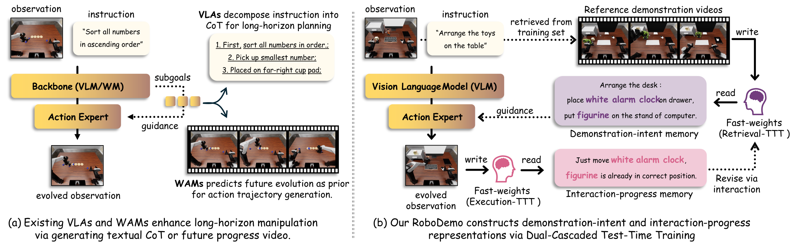
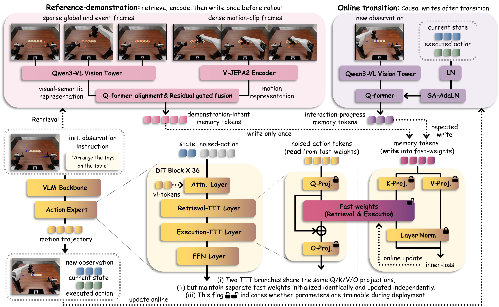
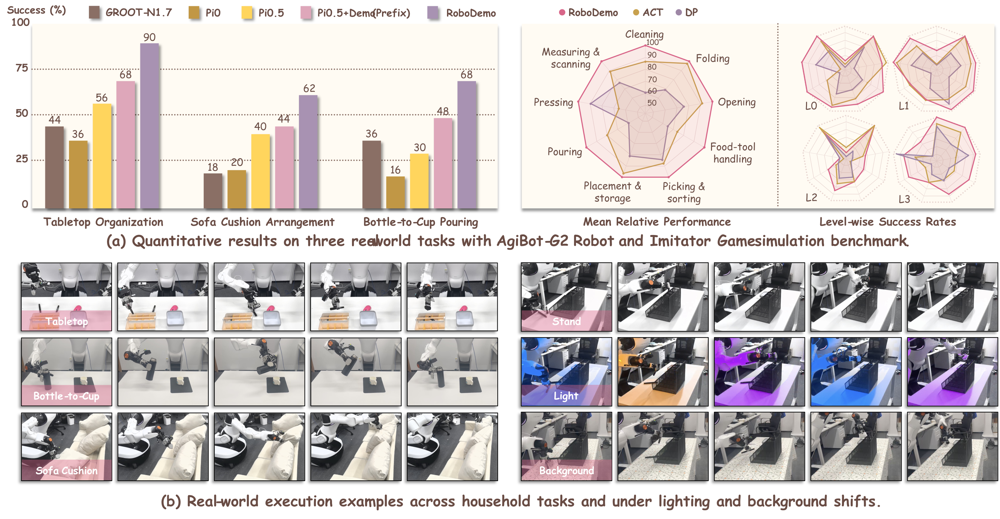

<div align="center">

<h1>RoboDemo</h1>
<h3>Reconciling Demonstration Intent and Execution Progress<br>for Long-Horizon Manipulation</h3>

<p>Anonymous Authors &middot; Manuscript under review</p>

<p>
  <a href="https://robodemo-2027.github.io/"><strong>Project Page</strong></a>
  &nbsp;&nbsp;&middot;&nbsp;&nbsp;
  <a href="https://huggingface.co/collections/mxk1998/robodemo-6afc7693656d0965ce5466bc"><strong>Model Weights</strong></a>
  &nbsp;&nbsp;&middot;&nbsp;&nbsp;
  <a href="#method"><strong>Method</strong></a>
  &nbsp;&nbsp;&middot;&nbsp;&nbsp;
  <a href="#models-and-results"><strong>Results</strong></a>
  &nbsp;&nbsp;&middot;&nbsp;&nbsp;
  <a href="#evaluation"><strong>Evaluate</strong></a>
</p>

</div>

## Release Status

- [x] **Code:** model architecture, dual-memory inference, evaluator and environment.
- [x] **Models & results:** five checkpoints, trial plans, normalization and 3,600 episode logs.
- [x] **Verified:** all five models completed a 500-step simulator test. [View the runs](docs/smoke-evaluation.md).
- [ ] **Next release:** training code, training-data preparation and launch recipes.

## Overview

> **A demonstration describes how a task should proceed.
> Interaction reveals how execution has actually progressed.**

<a href="docs/assets/paper/teaser.pdf">
  
</a>

*Figure 1. From generated guidance to retrieved video as guidance.
RoboDemo preserves reference guidance while tracking actual execution.*
[Full-resolution PDF](docs/assets/paper/teaser.pdf)

RoboDemo is a demonstration-augmented manipulation framework built on
**Dual-Cascaded Test-Time Training**. A task-relevant human demonstration,
or a compatible robot video retrieved from the training corpus, supplies
persistent **demonstration-intent memory**. Online observations, robot states
and executed actions accumulate a separate **interaction-progress memory**.
The action expert first reads reference intent, then refines it with realized
progress, adapting to execution deviations without overwriting the stored
procedure.

| Imitator Game: C15 / C30 / C45 | Imitator Game: Full50 | Real-world household tasks |
| :---: | :---: | :---: |
| **90.7%** mean Seen-task SR | **84.6%** overall SR | **73.3%** mean SR |
| Five shared Seen tasks, three training scales | All 50 tasks, 2,000 episodes | Three tasks on AgiBot-G2 |

## Method

<a href="docs/assets/paper/method.pdf">
  
</a>

*Figure 2. Overview of RoboDemo.*
[Full-resolution PDF](docs/assets/paper/method.pdf)

1. **Select a reference.** Use a task-relevant human demonstration, or retrieve
   a robot video with Refreward using the instruction and initial observation.
2. **Encode demonstration intent.** Hierarchical Global-Event-Clip sampling
   combines sparse semantic frames with a dense motion clip. Frozen Qwen3-VL
   and V-JEPA2 encoders, Q-former alignment and gated fusion produce reference
   memory tokens, written to Retrieval-TTT before rollout.
3. **Track interaction progress.** Encode each completed transition using the
   new observation, current robot state and preceding executed action.
   State-action-conditioned adaptive normalization forms tokens that update
   Execution-TTT causally.
4. **Read in cascade.** Within each Action-DiT block, Retrieval-TTT supplies
   reference guidance, then Execution-TTT refines the reference-conditioned
   action representation using realized progress.

**Cross-Memorization separates context writes from action reads.**
The two branches share learned projections and initialization but maintain
independent fast-weight states. Learned policy parameters remain fixed at
deployment, and both memory states remain fixed during action denoising.

## Models And Results

### Simulation

The Imitator Game benchmark evaluates execution under four scene levels:
L0 preserves the reference scene; L1, L2 and L3 vary object positions,
appearance and functional affordances, respectively.

**Full50: 84.6% success across all 50 Imitator Game tasks.**
[RoboDemo-full50](https://huggingface.co/mxk1998/RoboDemo-full50), at
240,000 updates, completes 1,692 of 2,000 episodes. The paper reports
64.1% for DP and 74.9% for ACT (SigLIP2) on this full suite.

**Training-scale evaluation.** C15, C30 and C45 train on nested corpora of
15, 30 and 45 tasks, while sharing five Seen and five Unseen evaluation
tasks. Each released nested-corpus evaluation contains 200 Seen and
200 Unseen episodes.

| Model | Checkpoint | Reference | Seen SR (%) | Unseen SR (%) |
| --- | ---: | --- | ---: | ---: |
| [RoboDemo-c15](https://huggingface.co/mxk1998/RoboDemo-c15) | 90,000 | Human | 89.5 | 0.0 |
| [RoboDemo-c30](https://huggingface.co/mxk1998/RoboDemo-c30) | 160,000 | Human | 94.0 | 0.5 |
| [RoboDemo-c45](https://huggingface.co/mxk1998/RoboDemo-c45) | 260,000 | Human | 88.5 | 11.5 |
| [RoboDemo-c15-wo](https://huggingface.co/mxk1998/RoboDemo-c15-wo) | 100,000 | Retrieved robot | 90.0 | 0.0 |

The equally weighted C15/C30/C45 Seen mean is **90.7%**, compared with
80.8% for ACT/DINOv2 in the paper. With retrieved robot references,
C15-wo reaches **90.0%** Seen SR versus 89.5% with human demonstrations.
For C15-wo, Unseen denotes tasks held out from policy training; task-matched
robot references are supplied from the benchmark training bank.

[All 360 task-level results](results/README.md) &middot;
[Download the five checkpoints](https://huggingface.co/collections/mxk1998/robodemo-6afc7693656d0965ce5466bc)

Each linked checkpoint is the one used for its reported results.
Weights are hosted on Hugging Face; this repository contains the code and logs.

### Real-World Evaluation

<a href="docs/assets/paper/exper.pdf">
  
</a>

*Figure 3. Real-world evaluation and simulation performance profiles.
The upper-left panel reports real-world task SR; the upper-right panels
show group-relative performance and level-wise SR on Full50.
The lower panels show real-world executions and visual shifts.*
[Full-resolution PDF](docs/assets/paper/exper.pdf)

The paper evaluates three household tasks on the **AgiBot-G2 humanoid**,
with 50 trials per method and task:

| Task | RoboDemo SR (%) |
| --- | ---: |
| Tabletop Organization | 90.0 |
| Bottle-to-Cup Pouring | 68.0 |
| Sofa Cushion Arrangement | 62.0 |
| **Mean** | **73.3** |

The three-task mean exceeds the demonstration-prefix baseline by
**20.0 percentage points**. On Tabletop Organization, RoboDemo achieves
**46%** under changed lighting and **76%** under a changed background,
without target-condition fine-tuning.

<details>
<summary><strong>Context and memory ablation on C15-Seen</strong></summary>

| Context organization | SR (%) |
| --- | ---: |
| Base VLA | 62.0 |
| Demonstration prefix | 68.5 |
| Retrieval-TTT only | 71.5 |
| Demonstration and execution in one TTT | 73.0 |
| Two separate TTT modules, parallel reads | 82.0 |
| **Dual-Cascaded TTT (RoboDemo)** | **89.5** |

Separate memories avoid coupling stable reference intent to evolving
execution context. Cascaded reads improve over parallel reads by
7.5 percentage points.

</details>

## Installation

**Linux &middot; Python 3.10 &middot; PyTorch 2.6.0 / CUDA 12.4**

The evaluator uses Transformers 4.57.6, SAPIEN 3.0.3 and Gymnasium 0.29.1.
See [environment setup](environments/README.md) for the full dependency
inventory and rendering configuration.

<details>
<summary><strong>Install the evaluation environment</strong></summary>

```bash
python -m venv .venv
source .venv/bin/activate
pip install torch==2.6.0 torchvision==0.21.0 \
  --index-url https://download.pytorch.org/whl/cu124
pip install -r environments/requirements-evaluation.txt
pip install flash-attn==2.7.4.post1 --no-build-isolation
```

</details>

## Data Preparation

Follow the [Imitator Game project](https://imitator-game.github.io/) to obtain
the IG-10K dataset, simulator and assets. Use the paired human-reference and
simulation subsets. Dataset media are distributed by the benchmark.

<details>
<summary><strong>Configure data, simulator and pretrained encoder paths</strong></summary>

```bash
export ROBODEMO_DATA_ROOT=/data/IG-10K-Dataset
export IMITATOR_GAME_ROOT=/path/to/ImitationGame
export MS_ASSET_DIR=/data/maniskill
export ROBODEMO_QWEN=/models/Qwen3-VL-4B-Instruct
export ROBODEMO_XR1=/models/Xiaomi-Robotics-1-5B
export ROBODEMO_VJEPA2_SOURCE=/path/to/vjepa2
export ROBODEMO_VJEPA2_WEIGHTS=/models/vjepa2-ac-vitg.pt
export PYTHONPATH="$IMITATOR_GAME_ROOT${PYTHONPATH:+:$PYTHONPATH}"
```

The pretrained components are
[Qwen3-VL](https://huggingface.co/Qwen/Qwen3-VL-4B-Instruct),
[Xiaomi-Robotics-1](https://huggingface.co/XiaomiRobotics/Xiaomi-Robotics-1-5B)
and [V-JEPA2](https://github.com/facebookresearch/vjepa2).
Their original distribution terms apply.

`configs/*_trials.json` contains the reference identities and seeds used by the
reported experiments. Paths inside those files are relative to the IG-10K
dataset root. C15-wo also includes its 400 selected robot-reference identities
and candidate scores.

</details>

## Evaluation

Use a downloaded policy checkpoint and a GPU allocated to your job:

```bash
CUDA_VISIBLE_DEVICES=0 python evaluation/evaluate.py \
  --model c15 \
  --checkpoint /models/RoboDemo-c15/pytorch_model.pt \
  --data-root "$ROBODEMO_DATA_ROOT" \
  --output outputs/c15
```

Choose `full50`, `c15`, `c30`, `c45` or `c15-wo`, with its corresponding
checkpoint. Use a new output directory for each evaluation.

| To evaluate | Add |
| --- | --- |
| One complete episode | `--max-episodes 1` |
| A nested-corpus split | `--split seen` or `--split unseen` |
| A task-level subset | `--task-level L0_TwoRobotFoldTowel-v1` |

All five released checkpoints have passed a real 500-step simulator run.
[Verification report and commands](docs/smoke-evaluation.md).

<details>
<summary><strong>Evaluation protocol and C15-wo references</strong></summary>

The episode limit changes the trial count, not the 500-control-step horizon.

The evaluator queries the policy every control step, retains a new action
chunk every four steps, and combines up to four overlapping chunks.
Each applied, bounded action is fed back into execution memory.
An episode is successful if the benchmark success condition is reached
within the 500-control-step horizon.

For the reported C15-wo episodes, the evaluator reuses the published
initial-observation retrieval selections. `evaluation/retrieval.py` also
provides the original query-conditioned scorer for a prepared candidate
feature bank; see [reference retrieval](docs/retrieval.md).

</details>

## Evaluation Logs

`results/<model>/episodes.jsonl` contains the completed episode records with
task, level, seed, reference, success and timing fields. Recompute the
published summary without loading a model:

```bash
python evaluation/summarize.py results/*/episodes.jsonl
python -m pytest tests
ROBODEMO_TEST_VARIANT=robot python -m pytest tests
```

The result package covers 3,600 episodes.

## Code Layout

<details>
<summary><strong>Browse the repository structure</strong></summary>

| Directory | Contents |
| --- | --- |
| `models/human/demottt` | Human-reference policy, reference encoder and dual-memory modules |
| `models/robot/demottt` | Robot-reference policy and video adapter |
| `models/robot/refreward` | Retrieval model and frozen feature extractors |
| `evaluation` | Rollout, action aggregation, reference selection and summarization |
| `configs` | Inference configurations, normalization and trial manifests |
| `environments` | Evaluation dependency versions and simulator setup |
| `results` | Episode logs, summary and per-task tables |
| `docs/assets/paper` | Paper figures: original SVG and PDF, with web previews |

The two policy source trees preserve their respective evaluation
implementations. The original `demottt` module name is retained for checkpoint
compatibility. Training launchers, optimizers and checkpoint-resume tooling
will be released in the next stage.

</details>

## Acknowledgments

This implementation builds on Imitator Game, StarVLA, Xiaomi-Robotics-1,
Qwen3-VL, V-JEPA2, LeRobot and OpenVLA. Upstream source notices are preserved
in the code and [licenses](licenses/). See [NOTICE](NOTICE.md).

RoboDemo code is released under the [MIT License](LICENSE). Third-party
components retain their respective licenses.

## Anonymous Citation

```bibtex
@misc{anonymous2027robodemo,
  title  = {RoboDemo: Reconciling Demonstration Intent and Execution
            Progress for Long-Horizon Manipulation},
  author = {Anonymous Authors},
  year   = {2027},
  note   = {Manuscript under review}
}
```
